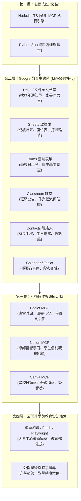
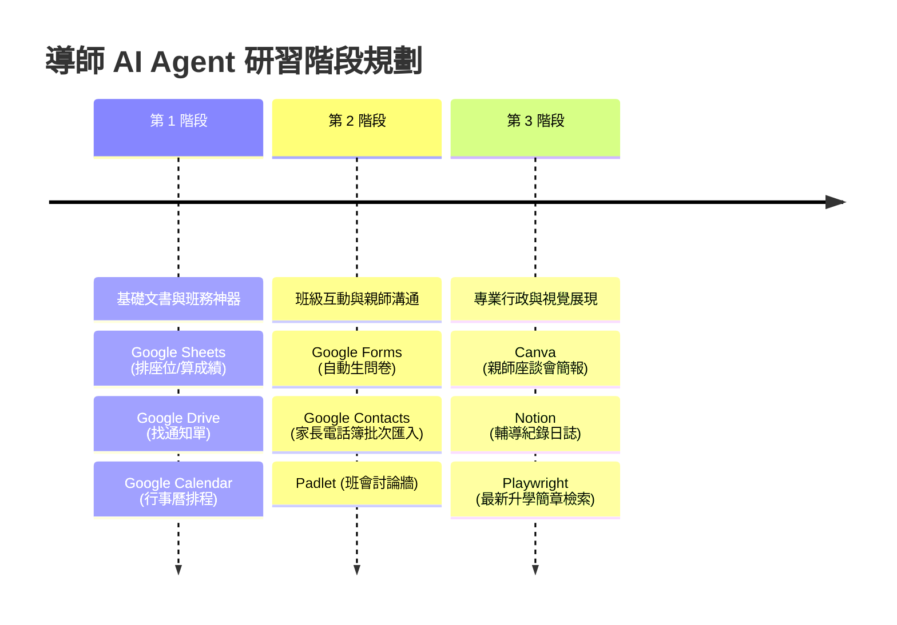

# 高中職與國中導師專用：AI Agent 通用工具棧與公開 MCP 安裝推薦指南

本指南專為**推廣給各級學校導師**使用而設計。清單中所列項目皆為**網路上公開、開源、官方支援且已被廣泛驗證**之成熟工具，完全**不包含任何個人私有知識庫、私人專案或校本私密技能**。

---

## 一、導師工作場景與 AI 工具矩陣圖

---

## 二、第一模組：Google 教育生態系（完全免費、官方公開）

學校老師普遍使用 Google Workspace for Education，以下功能皆為 Google 官方公開 API，能直接解決導師繁雜的班務痛點：

### 1. Google 試算表（Google Sheets）
* **公開來源**：Google Workspace API / 開源 `google-workspace-mcp`
* **導師實用痛點**：
  * **座位表與排座演算法**：讓 Agent 根據近視、身高級距或特殊需求自動排列座位表。
  * **幹部與打掃輪值表**：自動產生日程表與輪值名單。
  * **定期考生成績分析**：自動計算各科平均、級距分佈與進退步榜單。

### 2. Google 雲端表單（Google Forms）
* **公開來源**：Google Forms API
* **導師實用痛點**：
  * **一秒生成調查表單**：輸入題目需求，AI 直接在雲端建立「學校日家長出席調查表」、「幹部改選投票」或「高二分組性向調查」。
  * **回覆即時彙整**：表單收單後，Agent 自動讀取回覆並產出分析摘要給導師。

### 3. Google 雲端硬碟全文檢索（Google Drive）
* **公開來源**：Google Drive API v3
* **導師實用痛點**：
  * **歷年班務範本秒查**：導師常忘記前幾年存的「班級公約」、「給家長的一封信」放在哪，AI 可直接全文字詞秒搜，直接附上開啟連結。

### 4. Google 教室（Google Classroom）
* **公開來源**：Google Classroom API
* **導師實用痛點**：
  * **班級事務公告一鍵發布**：週記題目、隔天應帶物品、校慶提醒。
  * **缺交名單即時清查**：比對誰尚未繳交作業並列出清冊。

### 5. Google 聯絡人（Google Contacts / People API）
* **公開來源**：Google People API
* **導師實用痛點**：
  * **家長電話簿整班匯入**：開學時將 Excel 家長通訊錄一鍵批次建立，不用手動一筆筆 key 手機。
  * **學生生日提醒**：自動寫入生日欄位，手機或 Google 日曆會在學生生日當天自動提醒導師。

### 6. Google 日曆與待辦（Google Calendar & Tasks）
* **公開來源**：Google Calendar API / Google Tasks API
* **導師實用痛點**：
  * 將學校全學期「行事曆 PDF」讓 AI 讀取後，一鍵把「段考、模擬考、學校日、作業抽查、畢業旅行」直接排入導師的個人日曆。

---

## 三、第二模組：互動看板與協作筆記（公開開源 MCP）

### 1. Padlet MCP
* **開源公開套件**：`padlet-mcp`（npm 公開套件，支援標準 MCP 協定）
* **公開連結**：[Padlet 官方開發者平台](https://padlet.dev/) ｜ [npm: padlet-mcp](https://www.npmjs.com/package/padlet-mcp)
* **導師實用情境**：
  * **班會主題討論**：學生以手機掃 QR Code 發言，AI 自動在 Padlet 看板上分類與摘要觀點。
  * **生活反思與閱讀心得牆**：全班心得成果展現，家長學校日可直接觀賞。

### 2. Notion MCP
* **官方公開套件**：`@notionhq/notion-mcp-server`（Notion 官方釋出之開源 MCP）
* **公開連結**：[Notion 官方 MCP GitHub](https://github.com/mcp/notion) ｜ [Notion 整合指南](https://developers.notion.com/)
* **導師實用情境**：
  * **導師班級經營知識庫**：班規、常規獎懲記錄、整學年活動紀錄。
  * **學生輔導個案觀察日誌**：記錄每一次親師通話摘要、學生輔導談話要點，方便交接或親師溝通查閱。

---

## 四、第三模組：視覺與班級文宣設計（公開開源 MCP）

### 1. Canva MCP
* **官方公開套件**：`@canva/cli`（Canva 官方命令列與 MCP 支援）
* **公開連結**：[Canva 開發者入口](https://www.canva.dev/)
* **導師實用情境**：
  * **學校日/班親會簡報自動排版**：提供大綱，AI 自動協助生成結構優美的投影片。
  * **班級榮譽海報、座位表美化卡、校慶加油布條**。

---

## 五、第四模組：公開升學與教育資訊檢索

### 1. 網頁瀏覽自動化（Playwright / Browse CLI）
* **開源公開套件**：`@playwright/mcp`
* **公開連結**：[Playwright 官網](https://playwright.dev/)
* **導師實用情境**：
  * **升學考試即時查閱**：自動上大考中心（CEEC）查詢最新學測/分科試務時程、報名日期與考區交通資訊。
  * **升學簡章即時下載**：大學繁星推薦、個人申請參採科目自動抓取。

### 2. 公開網路搜尋引擎（Tavily Search / Fetch）
* **開源公開套件**：`tavily-mcp` 或通用 `fetch`
* **導師實用情境**：
  * 查詢最新青少年心理輔導文章、班級經營破冰遊戲靈感、教育時事討論素材。

---

## 六、導師研習推廣：三階段安裝建議進度表

在為其他老師辦理研習或協助安裝時，建議採取**「由淺入深、漸進堆疊」**的三階段策略：

| 階段 | 推薦安裝項目 | 預估上手時間 | 帶給導師的立即效益 |
| :---: | :--- | :---: | :--- |
| **初階入門 (第一週)** | • Node.js LTS • Google Drive + Sheets + Calendar | 15 分鐘 | 一鍵排出複雜座位表、試算表算成績、行事曆自動標註段考日程。 |
| **中階進階 (第二週)** | • Google Forms + Contacts • Padlet 看板 | 20 分鐘 | 開學調查表單自動產生、家長通訊錄一鍵匯入、班會學生互動牆。 |
| **高階精進 (第三週)** | • Canva 視覺設計 • Notion 班級手冊 • 網頁檢索 (Playwright) | 30 分鐘 | 學校日專業美觀簡報生成、歷年學生輔導紀錄完整建檔、最新升學規準秒查。 |

---

## 七、給其他老師的「零痛點」電腦底座安裝標準配備

在其他電腦安裝前，僅需確認以下 3 項通用免費開源工具：
1. **Node.js LTS**（建議 20.x 或 22.x，直接在 [nodejs.org](https://nodejs.org/) 下載安裝檔，下一步到底）。
2. **Google 帳號**（直接使用教育局 `@lssh.tp.edu.tw` 或個人 Gmail）。
3. **任一款支援 MCP 的 AI Agent**（例如 Antigravity、Claude Code、Codex 或 OpenCode）。

> [!NOTE]
> **後續擴充步驟**：
> 當其他導師熟悉上述通用公開工具後，未來您若評估哪些「校本模組」或「教學技能」適合分享（例如去識別化的公版素養命題規準、班級常規指引範本等），再以擴充 Skill 的形式逐步分發給有需要的老師即可！
