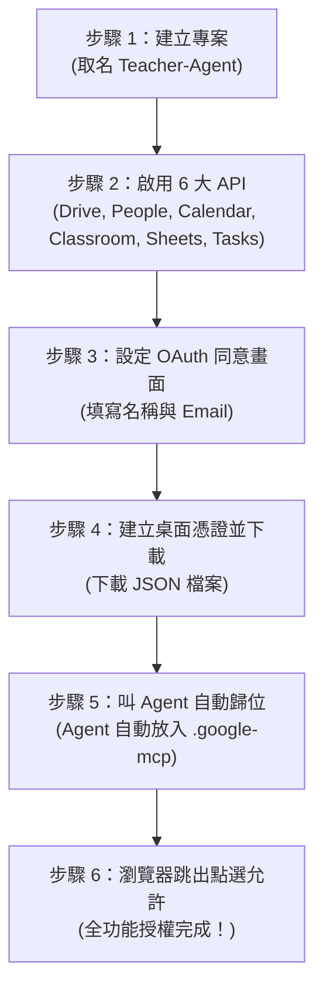

# Google API 開通與授權「保姆級」圖解逐步操作指南

> 🗣️ **老師偷懶秘笈（不想自己看文字嗎？）**：  
> 您完全不需要自己讀完這份落落長的手冊！直接把這句話複製貼給您的 AI Agent：  
> **「請讀取 `GOOGLE_API_STEP_BY_STEP_GUIDE.md`，啟動保姆引導模式，一步一步帶我開通 Google API，一次只講一步，我說好了你再說下一步！」**  
> 您的 Agent 就會啟動專屬家教模式，一次給您一個網址，手把手帶您點擊完成！

---

> 💡 **老師的行前安心定心丸**：
> 1. **100% 完全免費**：不需要綁定信用卡、不需要輸入任何付款資訊，完全在 Google 官方提供的免費教育/個人配額內。
> 2. **100% 個人隱私安全**：這是您在「自己的 Google 帳號下」建立的私有金鑰，所有授權與資料僅在您的電腦與 Google 伺服器之間流通，絕不會經過任何第三方。
> 3. **免找隱藏資料夾**：下載憑證後，**完全不需要老師手動去找 `.google-mcp` 隱藏目錄**，只要叫 Agent 幫您搬移即可！

---

## 快速流程圖

---

## 步驟 1：建立 Google Cloud 專案（約 30 秒）

1. 點擊開啟直達網址 👉 **[Google Cloud 建立專案頁面](https://console.cloud.google.com/projectcreate)**。
2. 登入您的 Google 帳號（個人 Gmail 或學校教育帳號 `@school.tp.edu.tw` 均可）。
3. 看到「專案名稱 (Project Name)」欄位，輸入：`Teacher-Agent`。
4. 機構與位置保持預設，直接點擊下方藍色按鈕 **「建立 (CREATE)」**。
5. （等待約 5~10 秒，頁面右上角通知鈴鐺會顯示「專案建立成功」）。

---

## 步驟 2：啟用 6 大核心教學 API（約 2 分鐘）

點擊開啟直達網址 👉 **[Google API 服務庫 (API Library)](https://console.cloud.google.com/apis/library)**。

在中間上方的搜尋框，依序搜尋以下 6 個 API，點進去後按下藍色的 **「啟用 (ENABLE)」** 按鈕：

| 次序 | 請在搜尋框輸入 | 點進去後的名稱 | 功能說明 |
| :---: | :--- | :--- | :--- |
| **1** | `Google Drive API` | **Google Drive API** | 雲端硬碟全文極速秒搜 |
| **2** | `People API` | **People API** | Google 聯絡人與通訊錄管理 |
| **3** | `Google Calendar API` | **Google Calendar API** | Google 日曆行程自動排程 |
| **4** | `Google Classroom API`| **Google Classroom API** | Classroom 課堂公告與作業查詢 |
| **5** | `Google Sheets API` | **Google Sheets API** | 試算表讀寫與成績處理 |
| **6** | `Google Tasks API`  | **Google Tasks API**  | 待辦事項與工作清單自動化排程 |

*(每按一次「啟用」後，點左上角「←」回到 API 服務庫搜尋下一個，6 個都按「啟用」即可)*。

---

## 步驟 3：設定 OAuth 同意畫面（約 1 分鐘）

點擊開啟直達網址 👉 **[OAuth 同意畫面設定頁](https://console.cloud.google.com/apis/credentials/consent)**。

1. **選擇使用者類型 (User Type)**：
   * 如果使用**學校教育帳號**（有自己的學校網域）：請選 **「內部 (Internal)」**（最方便，免審查）。
   * 如果使用**一般個人 Gmail**（`@gmail.com`）：請選 **「外部 (External)」**。
   * 點選 **「建立 (CREATE)」**。
2. **填寫應用程式基本資訊**（只需填 3 處，其餘全部留空）：
   * **應用程式名稱 (App name)**：輸入 `Teacher Desktop Agent`
   * **使用者支援電子郵件 (User support email)**：點下拉選單，選您自己的 Email
   * **開發人員聯絡資訊 (Developer contact information)**：在最下方填入您自己的 Email
   * 點擊最下方藍色按鈕 **「儲存並繼續 (SAVE AND CONTINUE)」**。
3. **範圍 (Scopes)**：
   * 完全不用動，直接拉到最下方，點擊 **「儲存並繼續 (SAVE AND CONTINUE)」**。
4. **測試使用者 (Test users)**（僅使用「外部」的一般 Gmail 才需要，選「內部」會直接跳過）：
   * 點擊 **「＋ ADD USERS」**。
   * 輸入您自己的 Gmail 地址，按「儲存」。
   * 點擊最下方藍色按鈕 **「儲存並繼續」**。

---

## 步驟 4：建立桌面憑證並下載 JSON 檔案（約 30 秒）

點擊開啟直達網址 👉 **[憑證管理頁面 (Credentials)](https://console.cloud.google.com/apis/credentials)**。

1. 點擊頂端的 **「＋ 建立憑證 (CREATE CREDENTIALS)」**，在下拉選單選擇 **「OAuth 用戶端 ID (OAuth client ID)」**。
2. 在「應用程式類型 (Application type)」下拉選單中，選擇：**「桌面應用程式 (Desktop App)」**。
3. 名稱保持預設或填寫 `Teacher Client` 均可。
4. 點擊右下角藍色按鈕 **「建立 (CREATE)」**。
5. 螢幕會彈出「OAuth 用戶端已建立」視窗，請點擊右側的 **「下載 JSON (DOWNLOAD JSON)」** 按鈕。
6. 此時您的瀏覽器會下載一個類似 `client_secret_214096452487-xxxx.json` 的檔案到電腦的「下載」資料夾。

---

## 步驟 5：免找隱藏資料夾！叫 Agent 幫您自動搬移

很多老師找不到 `.google-mcp` 隱藏資料夾，這一步**完全不要手動去找！**

請直接回到您的 AI Agent 對話框，對 Agent 說這句話：
> 🗣️ **「我剛剛下載了 Google 的 client secret 檔案在『下載 (Downloads)』資料夾，請幫我找到它，重命名為 `client_secret.json` 並搬到我的 `~/.google-mcp/` 目錄中！」**

Agent 就會全自動在電腦中找到該檔案並搬移歸位！

---

## 步驟 6：最後一步！點擊瀏覽器完成「全滿貫授權」

檔案放好後，對 Agent 說：
> 🗣️ **「請幫我執行 `setup_google_auth.mjs` 進行 Google 授權！」**

1. 您的電腦瀏覽器會自動彈出 Google 登入視窗。
2. 登入您的 Google 帳號。
3. ⚠️ **重要避坑提示**：若畫面出現「*Google 尚未驗證這個應用程式 (Google hasn't verified this app)*」：
   * **不要害怕！** 這是因為這個應用程式是您剛才在自己帳號下建立的，Google 官方當然沒有公開驗證。
   * 請點擊左下角灰色的 **「進階 (Advanced)」**。
   * 點擊最下方的 **「前往 Teacher Desktop Agent（安全）(Go to ... (unsafe))」**。
4. 畫面會列出本次申請的權限（雲端硬碟、聯絡人、日曆、待辦事項 Tasks、課堂 Classroom 等），請**勾選全部核取方塊**，點擊 **「繼續 / 允許」**。
5. 瀏覽器顯示 **「🎉 Google 全功能授權成功！請關閉此分頁」**。

---

恭喜您！大功告成！您電腦上的 AI Agent 現在已經具備完整的 Google 雲端極速搜尋、行事曆排程、Classroom 課堂作業抓取、Google Tasks 待辦排程與通訊錄管理能力！
