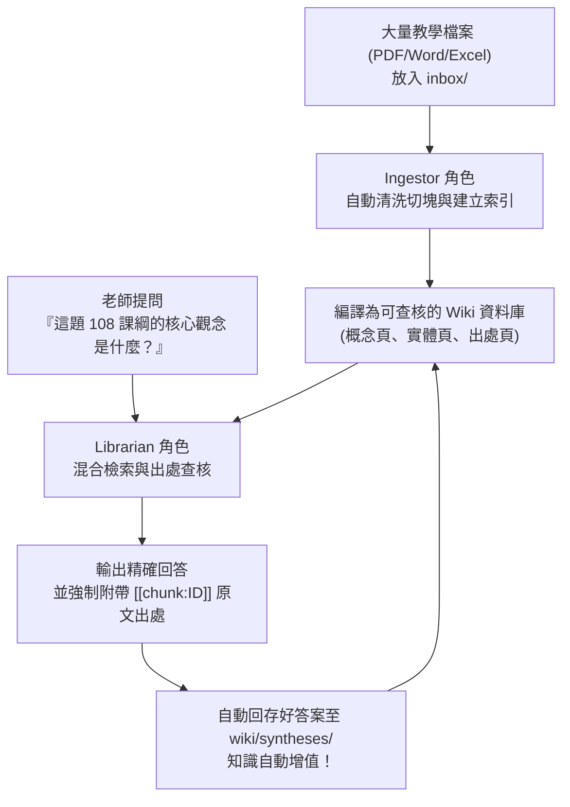
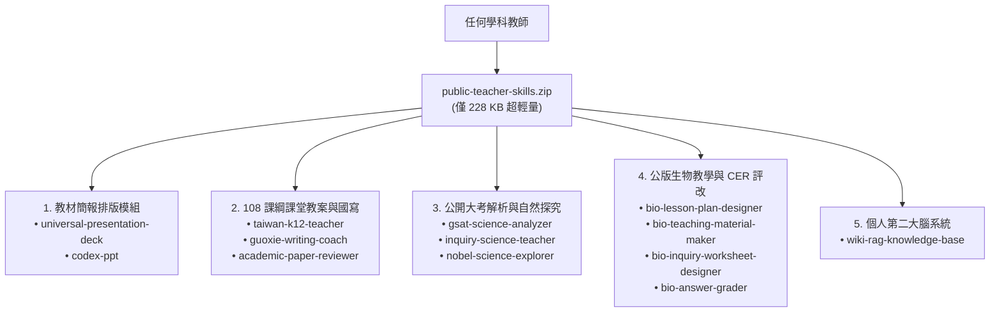

# 跨電腦・全自動通用 AI Agent MCP 安裝與 API 開通完整手冊

> **本手冊目標**：提供給任何學科教師、行政人員、研究人員或一般使用者。**無論電腦是全新乾淨的機器，或已經安裝部分工具**，只要將本文件交給 AI Agent（Antigravity、Claude Code、Codex、OpenCode、Cursor 等），Agent 即可按圖索驥完成環境檢查、安裝底座、部署極速雲端搜尋與日曆/課堂技能、引導開通 API、設定本地檔案處理工具，並帶領老師建立專屬的 **Wiki-RAG 本地知識庫**！
>
> 💡 **核心優勢**：
> 1. **全開源、全公開**：不含任何個人私有知識庫、帳密或校本機密。
> 2. **雙系統支援**：包含 macOS 與 Windows 的終端機指令與跨平台路徑。
> 3. **完整擁有全滿貫能力**：**Drive 極速搜尋**、**Contacts 通訊錄**、**Calendar 日曆排程**、**Classroom 課堂公告**、**Sheets 試算表**全部一次整合到位！
> 4. **教學檔案神手處理包**：整合 Word、Excel、PowerPoint、PDF 自動處理套件與「一句話咒語」。
> 5. **NotebookLM 第二大腦**：跨筆記本直連教學資料來源。
> 6. **Wiki-RAG 知識庫系統**：多 Agent 自動將大量講義與考卷編譯為可查核出處的結構化知識庫，知識每用一次就增值一次！
> 7. **一步到位授權**：授權腳本已預先配置完整 Scope，其他老師授權一次即享全部功能，絕不出現權限不足問題。

---

## 快速導覽目錄
1. [零基礎底座環境安裝（Node.js / Python / Git）](#一零基礎底座環境安裝node-與-python)
2. [免 API Key 工具（裝完立即可用）](#二免-api-key-工具完全零設定裝完立刻能用)
3. [教學檔案處理核心工具包（Word / Excel / PPT / PDF 神器）](#三教學檔案處理核心工具包word--excel--ppt--pdf-神器)
4. [Google 生態系 5 大 API 開通與一次性全授權流程](#四google-生態系-5-大-api-開通與一次性全授權流程)
5. [Google 核心技能原始碼（Drive 搜尋 ＋ 日曆 ＋ 課堂）](#五google-核心技能原始碼drive-搜尋--日曆--課堂-mcp)
6. [Google 聯絡人管理技能原始碼（Google Contacts MCP）](#六google-聯絡人管理技能原始碼google-contacts-mcp)
7. [Google 5 大功能狀態自動健檢腳本](#七google-5-大功能狀態自動健檢腳本)
8. [Google NotebookLM MCP 串接教學](#八google-notebooklm-mcp-串接教學)
9. [Padlet MCP 與 API 申請教學](#九padlet-mcp-與-api-key-申請教學)
10. [Notion MCP 與 Integration 申請教學](#十notion-mcp-與-integration-token-申請教學)
11. [Canva MCP 開通教學](#十一canva-mcp-開通教學)
12. [打造個人專屬 Wiki-RAG 教學知識庫（多 Agent 協作）](#十二打造個人專屬-wiki-rag-教學知識庫多-agent-協作)
13. [一鍵自動化安裝腳本（Agent 直接執行）](#十三一鍵自動化安裝腳本agent-直接執行)
14. [各大 AI Agent 設定檔對照表（手動查閱）](#十四各大-ai-agent-設定檔對照表手動查閱)
15. [精選臺灣教師專用 13 大教學 Skill 擴充包（純教學・零機密）](#十五精選臺灣教師專用-13-大教學-skill-擴充包純教學零機密)

---

## 一、零基礎底座環境安裝（Node 與 Python）

如果目標電腦是一台剛拿到或剛重灌的電腦，請先安裝以下兩個運行底座：

### 1. 安裝 Node.js LTS（MCP 伺服器核心執行環境）
* **圖形化安裝（最推薦老師使用）**：
  * 前往 [Node.js 官方網站](https://nodejs.org/) 下載 **LTS 版本**，點擊安裝檔一路點選「下一步 / 繼續」直到完成。
* **終端機指令安裝（Agent 可直接幫跑）**：
  * **macOS**：`brew install node`
  * **Windows**：`winget install OpenJS.NodeJS.LTS`
* **驗證安裝**：
  ```bash
  node -v   # 顯示 v20.x 或 v22.x
  npm -v    # 顯示 10.x 以上
  npx -v
  ```

---

### 2. 安裝 Python 3（資料運算與自動化腳本底座）
* **圖形化安裝**：
  * 前往 [Python 官網下載頁面](https://www.python.org/downloads/) 下載最新穩定版安裝包。
  * ⚠️ **Windows 注意**：安裝時請務必勾選最下方的 **「Add python.exe to PATH」**！
* **終端機指令安裝**：
  * **macOS**：`brew install python`
  * **Windows**：`winget install Python.Python.3.12`
* **驗證安裝**：
  ```bash
  python3 --version
  pip3 --version
  ```

---

## 二、免 API Key 工具（完全零設定，裝完立刻能用）

以下工具**完全不需要申請任何帳號或 API Key**，只要安裝好 Node.js，Agent 即可立即調用：

| 工具名稱 | 套件指令 | 功能與適用場景 |
| :--- | :--- | :--- |
| **Playwright 瀏覽器** | `npx -y @playwright/mcp` | 自動開啟無頭瀏覽器，爬取大考中心、教育局公告、各大學繁星申請規準與簡章。 |
| **Fetch 網頁閱讀器** | `npx -y @modelcontextprotocol/server-fetch` | 直接將任何公開網頁、新聞報導轉為 Markdown 給 Agent 閱讀分析。 |
| **Sequential Thinking** | `npx -y @modelcontextprotocol/server-sequential-thinking` | 時序思維鏈推理，適合複雜出題、跨學科邏輯拆解與除錯。 |

---

## 三、教學檔案處理核心工具包（Word / Excel / PPT / PDF 神器）

> 💡 **靈感來源**：感謝三師爸（Sense Bar）[ai-agent-ep03](https://github.com/mathruffian-dot/ai-agent-ep03) 開源專案。
> 這組 Python 工具能直接**給 Agent 裝上手腳**，讓 Agent 能夠直接在本機批次處理老師天天面對的文書檔案，**完全不需要 API Key**！

### 1. 一鍵安裝核心指令
在終端機中執行：
```bash
pip install python-docx openpyxl python-pptx pypdf PyMuPDF qrcode[pil] markitdown
```

### 2. 老師日常教學「一句話咒語速查表」

| 領域 | 老師常見痛點 | 常用套件 | 直接複製給 Agent 的指令範例 |
| :--- | :--- | :--- | :--- |
| **Word** | 30 位學生獎狀手動換名字換到手抽筋 | `python-docx` + `openpyxl` | 「讀這份班級名單 Excel，套進這個獎狀 Word 模板，每人產出一份並轉存成 PDF」 |
| **Word** | 出段考卷還要手動刪答案做學生版 | `python-docx` | 「把這些題目做成 Word，產出『學生卷（無答案）』與『教師卷（含詳解）』兩份」 |
| **Excel** | 段考算成績、排名、不及格標紅字 | `openpyxl` | 「讀 grades.xlsx，計算總分與排名，不及格自動標紅，算各班平均放最後一列」 |
| **Excel** | 全校成績大表要拆成各班給導師 | `openpyxl` | 「把這份全校成績表，依『班級』欄拆成一個班一個獨立 Excel 檔」 |
| **Excel** | 隨機排座位表或活動分組 | `openpyxl` | 「用這份學生名單隨機排一張 6×5 座位表，輸出成格式工整的 Excel」 |
| **PPT** | 教材大綱手動複製貼進投影片很慢 | `python-pptx` | 「把這份教材大綱，每個重點做成一頁投影片，套用學校公版簡報範本」 |
| **PPT** | 別人給的投影片字型雜亂、要加校徽 | `python-pptx` | 「把這份 PPT 全部字型改成標楷體，每頁右上角加上這張校徽圖檔」 |
| **PDF** | 歷屆段考試題、作業散在多個檔案 | `pypdf` + `PyMuPDF` | 「把這幾個 PDF 合併成一份，並把第 3 到第 5 頁抽出來另存新檔」 |
| **PDF** | 講義怕被外流想加浮水印 | `pypdf` | 「幫這份 PDF 每頁加上淡灰色浮水印『○○班 期中複習專用』」 |
| **工具** | 學生掃 Padlet 或表單，手做 QR 碼麻煩 | `qrcode[pil]` | 「把這 3 個連結各自生成一張清晰的 QR Code 圖片，直接貼入學習單」 |
| **工具** | 課本 PDF 格式雜亂想丟給 AI 閱讀 | `markitdown` | 「把這份課本 PDF 轉換為乾淨純淨的 Markdown 格式」 |

---

## 四、Google 生態系 5 大 API 開通與一次性全授權流程

> 💡 **老師的行前安心定心丸**：
> 1. **100% 完全免費**：不需要綁定信用卡、不需要輸入任何付款資訊，完全在 Google 官方提供的免費教育/個人配額內。
> 2. **100% 個人隱私安全**：這是您在「自己的 Google 帳號下」建立的私有金鑰，所有授權與資料僅在您的電腦與 Google 伺服器之間流通，絕不會經過任何第三方。
> 3. **免找隱藏資料夾**：下載憑證後，**完全不需要老師手動去找 `.google-mcp` 隱藏目錄**，只要叫 Agent 幫您搬移即可！
> 4. 另提供獨立詳細手冊：[`GOOGLE_API_STEP_BY_STEP_GUIDE.md`](GOOGLE_API_STEP_BY_STEP_GUIDE.md)。

---

### 步驟 1：建立 Google Cloud 專案（約 30 秒）
1. 點擊開啟直達網址 👉 **[Google Cloud 建立專案頁面](https://console.cloud.google.com/projectcreate)**。
2. 登入您的 Google 帳號（個人 Gmail 或學校教育帳號 `@school.tp.edu.tw` 均可）。
3. 看到「專案名稱 (Project Name)」欄位，輸入：`Teacher-Agent`。
4. 機構與位置保持預設，直接點擊下方藍色按鈕 **「建立 (CREATE)」**。
5. （等待約 5~10 秒，頁面右上角通知鈴鐺會顯示「專案建立成功」）。

---

### 步驟 2：啟用 5 大核心教學 API（約 2 分鐘）
點擊開啟直達網址 👉 **[Google API 服務庫 (API Library)](https://console.cloud.google.com/apis/library)**。

在中間上方的搜尋框，依序搜尋以下 5 個 API，點進去後按下藍色的 **「啟用 (ENABLE)」** 按鈕：
1. **Google Drive API**（搜尋 `Google Drive API`，用於雲端硬碟全文極速秒搜）
2. **People API**（搜尋 `People API`，用於 Google 聯絡人與家長通訊錄管理）
3. **Google Calendar API**（搜尋 `Google Calendar API`，用於日曆行程自動排程）
4. **Google Classroom API**（搜尋 `Google Classroom API`，用於課堂公告與作業查詢）
5. **Google Sheets API**（搜尋 `Google Sheets API`，用於試算表讀寫與成績處理）

*(每按一次「啟用」後，點瀏覽器上一頁或左上角「←」回到 API 服務庫搜尋下一個，5 個都按「啟用」即可)*。

---

### 步驟 3：設定 OAuth 同意畫面（約 1 分鐘）
點擊開啟直達網址 👉 **[OAuth 同意畫面設定頁](https://console.cloud.google.com/apis/credentials/consent)**。

1. **選擇使用者類型 (User Type)**：
   * 學校教育帳號（有自己網域）：請選 **「內部 (Internal)」**（最方便，免審查）。
   * 一般個人 Gmail（`@gmail.com`）：請選 **「外部 (External)」**。
   * 點選 **「建立 (CREATE)」**。
2. **填寫應用程式基本資訊**（只需填 3 處，其餘全部留空）：
   * **應用程式名稱 (App name)**：輸入 `Teacher Desktop Agent`
   * **使用者支援電子郵件 (User support email)**：選您自己的 Email
   * **開發人員聯絡資訊 (Developer contact information)**：填入您自己的 Email
   * 點擊最下方藍色按鈕 **「儲存並繼續 (SAVE AND CONTINUE)」**。
3. **範圍 (Scopes)**：完全不用動，直接拉到最下方點擊 **「儲存並繼續」**。
4. **測試使用者 (Test users)**（僅「外部」Gmail 才需要）：
   * 點擊 **「＋ ADD USERS」**，輸入您自己的 Gmail 地址，按「儲存」，再點「儲存並繼續」。

---

### 步驟 4：建立桌面憑證並下載 JSON 檔案（約 30 秒）
點擊開啟直達網址 👉 **[憑證管理頁面 (Credentials)](https://console.cloud.google.com/apis/credentials)**。

1. 點擊頂端的 **「＋ 建立憑證 (CREATE CREDENTIALS)」**，在下拉選單選擇 **「OAuth 用戶端 ID (OAuth client ID)」**。
2. 應用程式類型選取：**「桌面應用程式 (Desktop App)」**。
3. 名稱填寫 `Teacher Client`，點擊右下角藍色按鈕 **「建立 (CREATE)」**。
4. 彈出「OAuth 用戶端已建立」視窗，點擊右側的 **「下載 JSON (DOWNLOAD JSON)」** 按鈕。
5. 此時您的瀏覽器會下載一個類似 `client_secret_214096452487-xxxx.json` 的檔案到電腦的「下載」資料夾。

---

### 步驟 5：免找隱藏資料夾！叫 Agent 幫您自動搬移
很多老師找不到 `.google-mcp` 隱藏資料夾，這一步**完全不要手動去找！**

請直接回到您的 AI Agent 對話框，對 Agent 說這句話：
> 🗣️ **「我剛剛下載了 Google 的 client secret 檔案在『下載 (Downloads)』資料夾，請幫我找到它，重命名為 `client_secret.json` 並搬到我的 `~/.google-mcp/` 目錄中！」**

Agent 就會全自動在電腦中找到該檔案並搬移歸位！

---

### 步驟 6：最後一步！點擊瀏覽器完成「全滿貫授權」
檔案放好後，對 Agent 說：
> 🗣️ **「請幫我執行 `setup_google_auth.mjs` 進行 Google 授權！」**

1. 電腦瀏覽器會自動彈出 Google 登入視窗。
2. 登入您的 Google 帳號。
3. ⚠️ **重要避坑提示**：若畫面出現「*Google 尚未驗證這個應用程式 (Google hasn't verified this app)*」：
   * **不要害怕！** 這是因為這個應用程式是您剛才在自己帳號下建立的私有工具，Google 官方當然沒有公開驗證。
   * 請點擊左下角灰色的 **「進階 (Advanced)」**。
   * 點擊最下方的 **「前往 Teacher Desktop Agent（安全）(Go to ... (unsafe))」**。
4. 畫面會列出本次申請的權限（雲端硬碟、聯絡人、日曆、課堂 Classroom 等），請**勾選全部核取方塊**，點擊 **「繼續 / 允許」**。
5. 瀏覽器顯示 **「🎉 Google 全功能授權成功！請關閉此分頁」**。即刻大功告成！

---

## 五、Google 核心技能原始碼（Drive 搜尋 ＋ 日曆 ＋ 課堂 MCP）

請將以下程式碼存為 `~/.google-mcp/google-apps-script/index.js`，此腳本包含：
1. **`search_drive_files`**：雲端硬碟全文極速秒搜
2. **`list_calendar_events`**：Google 日曆行程查詢
3. **`create_calendar_event`**：Google 日曆行程新增
4. **`list_classroom_courses`**：Classroom 課堂班級讀取
5. **`list_classroom_announcements`**：Classroom 課堂公告讀取

```javascript
#!/usr/bin/env node
import fs from 'fs';
import path from 'path';
import { Server } from '@modelcontextprotocol/sdk/server/index.js';
import { StdioServerTransport } from '@modelcontextprotocol/sdk/server/stdio.js';
import { CallToolRequestSchema, ListToolsRequestSchema } from '@modelcontextprotocol/sdk/types.js';
import { OAuth2Client } from 'google-auth-library';
import { google } from 'googleapis';

const HOME = process.env.HOME || process.env.USERPROFILE;
const CLIENT_SECRET_PATH = path.join(HOME, '.google-mcp', 'client_secret.json');
const TOKEN_PATH = path.join(HOME, '.google-mcp', 'tokens', 'apps_script_and_search_token.json');

function getGoogleClients() {
  if (!fs.existsSync(CLIENT_SECRET_PATH)) throw new Error(`找不到憑證檔案: ${CLIENT_SECRET_PATH}`);
  if (!fs.existsSync(TOKEN_PATH)) throw new Error(`找不到 Token 檔案: ${TOKEN_PATH}`);

  const credentials = JSON.parse(fs.readFileSync(CLIENT_SECRET_PATH, 'utf8'));
  const installed = credentials.installed || credentials.web;
  const tokens = JSON.parse(fs.readFileSync(TOKEN_PATH, 'utf8'));

  const oauth2Client = new OAuth2Client(installed.client_id, installed.client_secret);
  oauth2Client.setCredentials(tokens);

  oauth2Client.on('tokens', (newTokens) => {
    const updated = { ...tokens, ...newTokens };
    fs.writeFileSync(TOKEN_PATH, JSON.stringify(updated, null, 2), 'utf8');
  });

  const drive = google.drive({ version: 'v3', auth: oauth2Client });
  const calendar = google.calendar({ version: 'v3', auth: oauth2Client });
  const classroom = google.classroom({ version: 'v1', auth: oauth2Client });
  return { drive, calendar, classroom };
}

const server = new Server({ name: 'google-suite-mcp', version: '1.0.0' }, { capabilities: { tools: {} } });

server.setRequestHandler(ListToolsRequestSchema, async () => ({
  tools: [
    {
      name: 'search_drive_files',
      description: '極速全文檢索 Google Drive 中的檔案（文件、試算表、簡報、PDF），返回檔名、連結與修改日期。',
      inputSchema: {
        type: 'object',
        properties: {
          query: { type: 'string', description: '搜尋關鍵字' },
          pageSize: { type: 'number', default: 20, description: '返回數量上限' }
        },
        required: ['query']
      }
    },
    {
      name: 'list_calendar_events',
      description: '列出 Google 日曆的行程活動。',
      inputSchema: {
        type: 'object',
        properties: {
          maxResults: { type: 'number', default: 10, description: '最多取得筆數' },
          timeMin: { type: 'string', description: '開始時間 (ISO 8601，預設為現在)' }
        }
      }
    },
    {
      name: 'create_calendar_event',
      description: '在 Google 日曆中新增行程活動。',
      inputSchema: {
        type: 'object',
        properties: {
          summary: { type: 'string', description: '行程標題' },
          description: { type: 'string', description: '詳細備註' },
          start: { type: 'string', description: '開始時間 (例如 2026-11-15T14:00:00+08:00 或 2026-11-15)' },
          end: { type: 'string', description: '結束時間 (例如 2026-11-15T15:00:00+08:00 或 2026-11-15)' },
          location: { type: 'string', description: '地點' }
        },
        required: ['summary', 'start', 'end']
      }
    },
    {
      name: 'list_classroom_courses',
      description: '列出 Google Classroom 中的課堂班級清單。',
      inputSchema: {
        type: 'object',
        properties: { pageSize: { type: 'number', default: 10, description: '最多取得課堂數' } }
      }
    },
    {
      name: 'list_classroom_announcements',
      description: '列出指定 Classroom 課堂中的公告事項。',
      inputSchema: {
        type: 'object',
        properties: {
          courseId: { type: 'string', description: '課堂 ID' },
          pageSize: { type: 'number', default: 10, description: '最多取得公告數' }
        },
        required: ['courseId']
      }
    }
  ]
}));

server.setRequestHandler(CallToolRequestSchema, async (request) => {
  const { name, arguments: args = {} } = request.params;
  const { drive, calendar, classroom } = getGoogleClients();

  if (name === 'search_drive_files') {
    const cleanQ = args.query.replace(/'/g, "\\'");
    const q = `trashed = false and (name contains '${cleanQ}' or fullText contains '${cleanQ}')`;
    const res = await drive.files.list({ q, pageSize: args.pageSize || 20, fields: 'files(id, name, mimeType, modifiedTime, webViewLink)', orderBy: 'modifiedTime desc' });
    const files = res.data.files || [];
    if (files.length === 0) return { content: [{ type: 'text', text: `未找到符合 "${args.query}" 的雲端檔案。` }] };
    const lines = files.map((f, i) => `[${i+1}] **${f.name}**\n  - 類型: ${f.mimeType}\n  - 修改時間: ${f.modifiedTime}\n  - 連結: ${f.webViewLink}`);
    return { content: [{ type: 'text', text: `搜尋 "${args.query}" 找到 ${files.length} 個檔案：\n\n` + lines.join('\n\n') }] };
  }

  if (name === 'list_calendar_events') {
    const timeMin = args.timeMin || (new Date()).toISOString();
    const res = await calendar.events.list({ calendarId: 'primary', timeMin, maxResults: args.maxResults || 10, singleEvents: true, orderBy: 'startTime' });
    const events = res.data.items || [];
    if (events.length === 0) return { content: [{ type: 'text', text: '近期無任何日曆行程。' }] };
    const lines = events.map((ev, i) => `[${i+1}] **${ev.summary || '未命名'}**\n  - 時間: ${ev.start?.dateTime || ev.start?.date} ~ ${ev.end?.dateTime || ev.end?.date}\n  - 連結: ${ev.htmlLink}`);
    return { content: [{ type: 'text', text: `近期 ${events.length} 個行程活動：\n\n` + lines.join('\n\n') }] };
  }

  if (name === 'create_calendar_event') {
    const reqBody = {
      summary: args.summary,
      description: args.description || '',
      location: args.location || '',
      start: args.start.includes('T') ? { dateTime: args.start } : { date: args.start },
      end: args.end.includes('T') ? { dateTime: args.end } : { date: args.end }
    };
    const res = await calendar.events.insert({ calendarId: 'primary', requestBody: reqBody });
    return { content: [{ type: 'text', text: `✅ 成功建立 Google 日曆活動：**${res.data.summary}**\n• 時間: ${res.data.start?.dateTime || res.data.start?.date}\n• 連結: ${res.data.htmlLink}` }] };
  }

  if (name === 'list_classroom_courses') {
    const res = await classroom.courses.list({ pageSize: args.pageSize || 10 });
    const courses = res.data.courses || [];
    if (courses.length === 0) return { content: [{ type: 'text', text: '未找到任何 Classroom 課堂。' }] };
    const lines = courses.map((c, i) => `[${i+1}] **${c.name}**\n  - 狀態: ${c.courseState} | 代碼: \`${c.enrollmentCode || '無'}\` | 課堂 ID: \`${c.id}\`\n  - 連結: ${c.alternateLink}`);
    return { content: [{ type: 'text', text: `共讀取到 ${courses.length} 門課堂：\n\n` + lines.join('\n\n') }] };
  }

  if (name === 'list_classroom_announcements') {
    const res = await classroom.courses.announcements.list({ courseId: args.courseId, pageSize: args.pageSize || 10 });
    const announcements = res.data.announcements || [];
    if (announcements.length === 0) return { content: [{ type: 'text', text: '課堂目前無任何公告。' }] };
    const lines = announcements.map((a, i) => `[${i+1}] **${a.text?.substring(0, 80) || '公告'}**\n  - 發布: ${a.creationTime} | 連結: ${a.alternateLink}`);
    return { content: [{ type: 'text', text: `共讀取到 ${announcements.length} 則公告：\n\n` + lines.join('\n\n') }] };
  }

  throw new Error(`未知工具: ${name}`);
});

async function main() {
  const transport = new StdioServerTransport();
  await server.connect(transport);
}
main().catch(console.error);
```

---

## 六、Google 聯絡人管理技能原始碼（Google Contacts MCP）

請將以下程式碼存為 `~/.google-mcp/google-contacts/index.js`：

```javascript
#!/usr/bin/env node
import fs from 'fs';
import path from 'path';
import { Server } from '@modelcontextprotocol/sdk/server/index.js';
import { StdioServerTransport } from '@modelcontextprotocol/sdk/server/stdio.js';
import { CallToolRequestSchema, ListToolsRequestSchema } from '@modelcontextprotocol/sdk/types.js';
import { OAuth2Client } from 'google-auth-library';
import { google } from 'googleapis';

const HOME = process.env.HOME || process.env.USERPROFILE;
const CLIENT_SECRET_PATH = path.join(HOME, '.google-mcp', 'client_secret.json');
const TOKEN_PATH = path.join(HOME, '.google-mcp', 'tokens', 'contacts_token.json');

function getPeopleClient() {
  if (!fs.existsSync(CLIENT_SECRET_PATH)) throw new Error(`找不到憑證: ${CLIENT_SECRET_PATH}`);
  if (!fs.existsSync(TOKEN_PATH)) throw new Error(`找不到 Token: ${TOKEN_PATH}`);

  const credentials = JSON.parse(fs.readFileSync(CLIENT_SECRET_PATH, 'utf8'));
  const installed = credentials.installed || credentials.web;
  const tokens = JSON.parse(fs.readFileSync(TOKEN_PATH, 'utf8'));

  const oauth2Client = new OAuth2Client(installed.client_id, installed.client_secret);
  oauth2Client.setCredentials(tokens);
  return google.people({ version: 'v1', auth: oauth2Client });
}

const server = new Server({ name: 'google-contacts', version: '1.0.0' }, { capabilities: { tools: {} } });

server.setRequestHandler(ListToolsRequestSchema, async () => ({
  tools: [
    {
      name: 'list_contacts',
      description: '列出 Google 通訊錄聯絡人清單（姓名、電話、Email、生日）。',
      inputSchema: {
        type: 'object',
        properties: { pageSize: { type: 'number', default: 50, description: '取得數量' } }
      }
    },
    {
      name: 'search_contacts',
      description: '依姓名、電話或 Email 搜尋聯絡人。',
      inputSchema: {
        type: 'object',
        properties: { query: { type: 'string', description: '搜尋關鍵字' } },
        required: ['query']
      }
    }
  ]
}));

server.setRequestHandler(CallToolRequestSchema, async (request) => {
  const people = getPeopleClient();
  if (request.params.name === 'list_contacts') {
    const { pageSize = 50 } = request.params.arguments || {};
    const res = await people.people.connections.list({
      resourceName: 'people/me',
      pageSize,
      personFields: 'names,phoneNumbers,emailAddresses,birthdays'
    });
    const connections = res.data.connections || [];
    const list = connections.map(p => {
      const name = p.names?.[0]?.displayName || '無姓名';
      const phone = p.phoneNumbers?.map(ph => ph.value).join(', ') || '無電話';
      const email = p.emailAddresses?.map(e => e.value).join(', ') || '無 Email';
      return `• **${name}**: 電話: ${phone} | Email: ${email}`;
    });
    return { content: [{ type: 'text', text: `共讀取到 ${connections.length} 位聯絡人：\n` + list.join('\n') }] };
  }
  if (request.params.name === 'search_contacts') {
    const { query } = request.params.arguments;
    const res = await people.people.searchContacts({ query, readMask: 'names,phoneNumbers,emailAddresses' });
    const results = res.data.results || [];
    if (results.length === 0) return { content: [{ type: 'text', text: `未找到符合 "${query}" 的聯絡人。` }] };
    const list = results.map(r => {
      const p = r.person;
      const name = p.names?.[0]?.displayName || '無姓名';
      const phone = p.phoneNumbers?.map(ph => ph.value).join(', ') || '無電話';
      return `• **${name}**: ${phone}`;
    });
    return { content: [{ type: 'text', text: `搜尋 "${query}" 結果：\n` + list.join('\n') }] };
  }
  throw new Error(`未知工具: ${request.params.name}`);
});

async function main() {
  const transport = new StdioServerTransport();
  await server.connect(transport);
}
main().catch(console.error);
```

---

## 七、Google 5 大功能狀態自動健檢腳本

安裝完成後，執行此腳本即可一秒確認 5 大功能是否全部連線成功：

```javascript
// 保存為 check_google_apis.mjs 並執行：node check_google_apis.mjs
import fs from 'fs';
import path from 'path';
import { google } from 'googleapis';
import { OAuth2Client } from 'google-auth-library';

const HOME = process.env.HOME || process.env.USERPROFILE;
const csPath = path.join(HOME, '.google-mcp', 'client_secret.json');
const tPath = path.join(HOME, '.google-mcp', 'tokens', 'apps_script_and_search_token.json');

async function test() {
  if (!fs.existsSync(csPath) || !fs.existsSync(tPath)) {
    console.log("❌ 尚未完成 client_secret.json 或 Token 授權！");
    return;
  }
  const cs = JSON.parse(fs.readFileSync(csPath)).installed;
  const oauth = new OAuth2Client(cs.client_id, cs.client_secret);
  oauth.setCredentials(JSON.parse(fs.readFileSync(tPath)));

  console.log("=== Google 5 大功能專案連線健檢 ===\n");

  try {
    const drive = google.drive({ version: 'v3', auth: oauth });
    const r = await drive.files.list({ pageSize: 1, fields: 'files(name)' });
    console.log("✅ 1. Google Drive 雲端搜尋: [正常] (最新檔案: " + r.data.files?.[0]?.name + ")");
  } catch(e) { console.log("❌ 1. Google Drive:", e.message); }

  try {
    const people = google.people({ version: 'v1', auth: oauth });
    const r = await people.people.connections.list({ resourceName: 'people/me', pageSize: 1, personFields: 'names' });
    console.log("✅ 2. Google Contacts 通訊錄: [正常] (聯絡人總數: " + r.data.totalPeople + ")");
  } catch(e) { console.log("❌ 2. Google Contacts:", e.message); }

  try {
    const cal = google.calendar({ version: 'v3', auth: oauth });
    const r = await cal.calendarList.list({ maxResults: 1 });
    console.log("✅ 3. Google Calendar 日曆: [正常] (主日曆: " + r.data.items?.[0]?.summary + ")");
  } catch(e) { console.log("❌ 3. Google Calendar:", e.message); }

  try {
    const cr = google.classroom({ version: 'v1', auth: oauth });
    const r = await cr.courses.list({ pageSize: 1 });
    console.log("✅ 4. Google Classroom 課堂: [正常] (課堂數: " + (r.data.courses?.length || 0) + ")");
  } catch(e) { console.log("❌ 4. Google Classroom:", e.message); }

  try {
    const sheets = google.sheets({ version: 'v4', auth: oauth });
    await sheets.spreadsheets.get({ spreadsheetId: 'dummy' });
  } catch(e) {
    if (e.code === 404) console.log("✅ 5. Google Sheets 試算表: [正常開通]");
    else console.log("⚠️ 5. Google Sheets:", e.message);
  }
}
test();
```

---

## 八、Google NotebookLM MCP 串接教學

> 💡 **靈感來源**：[antigravity-lazy-pack](https://github.com/mathruffian-dot/antigravity-lazy-pack)。
> 讓 Agent 直接讀取老師在 Google NotebookLM 裡存放的研習論文、課本筆記與學習講義！

1. **安裝 NotebookLM MCP CLI**：
   ```bash
   pip install notebooklm-mcp-cli
   ```
2. **在可見的終端機執行登入**：
   ```bash
   nlm login --profile default
   ```
   系統會開啟獨立的 Google 瀏覽器視窗，選取您的 Google 帳號完成登入。
3. **驗證與一鍵注入 Agent**：
   ```bash
   nlm doctor
   nlm setup add antigravity   # 若使用 Claude Code: nlm setup add claude
   ```
   完成後重啟 Agent，Agent 即可直接列出並查詢您的 NotebookLM 筆記本！

---

## 九、Padlet MCP 與 API Key 申請教學

1. 前往 [Padlet 官網](https://padlet.com/) 登入帳號。
2. 前往 [Padlet 開發者中心 (padlet.dev)](https://padlet.dev/) 申請 API Key。
3. 在 Agent 設定檔或終端機環境變數中設定：`"PADLET_API_KEY": "您的_Key"`。

---

## 十、Notion MCP 與 Integration Token 申請教學

1. 前往 [Notion 整合管理中心](https://www.notion.so/my-integrations) 點擊 **「+ New integration」**。
2. 取名為 `Teacher AI Agent`，複製以 `secret_` 開頭的金鑰。
3. 在 Notion 想授權的頁面右上角點擊 **「...」>「Connect to」** 授權該 Integration。
4. 設定給 Agent：`"NOTION_API_KEY": "secret_xxxx..."`。

---

## 十一、Canva MCP 開通教學

1. 前往 [Canva 開發者入口 (Canva Developers)](https://www.canva.dev/)。
2. 在終端機執行 `npx -y @canva/cli login`，瀏覽器跳出後點選授權即完成。

---

## 十二、打造個人專屬 Wiki-RAG 教學知識庫（多 Agent 協作）

> 🌟 **開源專案**：[froglssh/wiki-rag-knowledge-base](https://github.com/froglssh/wiki-rag-knowledge-base)
> **老師為什麼需要它？**
> 很多老師電腦裡有數十甚至數百份歷屆考古題、教學研究會紀錄、課綱指引、升學案例或實驗手冊。傳統做法是直接丟給 AI 閱讀，但檔案一多 AI 就會遺忘、產生幻覺或抓錯出處。
> 
> **Wiki-RAG 的核心智慧**：
> 「先把大量雜亂檔案清洗切塊，編譯成互相連結的 Wiki；提問時以精確切塊檢索並附上原文證據（`[[chunk:id]]`）；最後把好答案存回 Wiki——**知識庫每被使用一次，就自動增值一次！**」



### 1. 五大 Agent 角色分工（老師只需下指令）

不論您使用的是 Antigravity、Claude Code、Codex 還是 OpenCode，只要資料夾內放有規範正本 `AGENTS.md`，Agent 就會自動扮演以下角色：

| Agent 角色 | 老師什麼時候叫它？ | 它在後台做什麼？ |
| :--- | :--- | :--- |
| **Builder（建置者）** | 第一次建立知識庫時 | 盤點檔案類型、建立資料夾架構、配置檢索指令。 |
| **Ingestor（入庫者）** | 有新講義或考卷放進 `inbox/` 時 | 自動去重、還原代名詞、精準切塊、寫入 metadata 並編譯出 Wiki 概念頁。 |
| **Librarian（圖書館員）** | 老師日常提問時 | 依題型檢索、找出相關切塊、嚴格核對出處真偽後回答。 |
| **Maintainer（健檢員）** | 每週或大量匯入後 | 自動檢查是否有失效引用、矛盾論點或孤兒頁面。 |
| **Optimizer（優化器）** | 想要提高檢索精準度時 | 跑黃金測試題，自動調教檢索權重與切塊參數。 |

---

### 2. 老師「3 步驟快速建立」專屬教學知識庫

其他老師想要為自己的學科（例如「高一生物」、「國文寫作」、「升學輔導案例庫」）建立知識庫，只需極簡 3 步：

#### 步驟 1：建立知識庫資料夾
建立一個空資料夾（例如 `我的高中生物教學知識庫`），並從 [wiki-rag-knowledge-base](https://github.com/froglssh/wiki-rag-knowledge-base) 下載 [`templates/AGENTS.md`](https://raw.githubusercontent.com/froglssh/wiki-rag-knowledge-base/main/templates/AGENTS.md) 放入該資料夾。

#### 步驟 2：丟入原始教學檔案
在該資料夾內建立 `inbox/` 子目錄，將您平時累積的 10~20 份講義、考卷、教案 PDF 或 Word 丟進去。

#### 步驟 3：對您的 AI Agent 說這兩句話
1. **第一次初始化**：
   > 「請讀取 `AGENTS.md`，擔任 **Builder** 角色，盤點 `inbox/` 後為我建立知識庫架構。」
2. **正式編譯入庫**：
   > 「請擔任 **Ingestor** 角色，將 `inbox/` 中的所有新檔案清洗、切塊並編譯成 Wiki 頁面。」

完成後，這座知識庫就正式啟用！之後只要把新檔案丟進 `inbox/` 叫 Ingestor 處理；平常有任何教學疑問，直接問 Agent，它就會以「附帶出處與年份」的嚴謹方式為您提供精準解答！

---

## 十三、一鍵自動化安裝腳本（Agent 直接執行）

只要本機具備 Node.js 與 Python 3，請 Agent 在工作目錄中執行：
```bash
python3 install_universal_mcps.py
```

腳本會全自動建立 `~/.universal-mcp` 與 `~/.google-mcp` 目錄、下載相依 npm 套件、自動生成上述 Google 全功能 MCP 代碼，並無縫合併注入到本機的所有 Agent（Claude Code、OpenCode、Codex、Cursor）！

---

## 十四、各大 AI Agent 設定檔對照表（手動查閱）

### 1. Claude Code (`~/.claude.json`)
```json
{
  "mcpServers": {
    "google-suite": { "command": "node", "args": ["/Users/<您>/.google-mcp/google-apps-script/index.js"] },
    "google-contacts": { "command": "node", "args": ["/Users/<您>/.google-mcp/google-contacts/index.js"] },
    "playwright": { "command": "npx", "args": ["-y", "@playwright/mcp"] },
    "fetch": { "command": "npx", "args": ["-y", "@modelcontextprotocol/server-fetch"] },
    "notion": { "command": "npx", "args": ["-y", "@notionhq/notion-mcp-server"] },
    "padlet": { "command": "npx", "args": ["-y", "padlet-mcp"] },
    "canva": { "command": "npx", "args": ["-y", "@canva/cli", "mcp"] }
  }
}
```

### 2. OpenCode (`~/.config/opencode/opencode.jsonc`)
```jsonc
{
  "mcp": {
    "google-suite": { "type": "local", "command": ["node", "/Users/<您>/.google-mcp/google-apps-script/index.js"], "enabled": true },
    "google-contacts": { "type": "local", "command": ["node", "/Users/<您>/.google-mcp/google-contacts/index.js"], "enabled": true },
    "playwright": { "type": "local", "command": ["npx", "-y", "@playwright/mcp"], "enabled": true },
    "fetch": { "type": "local", "command": ["npx", "-y", "@modelcontextprotocol/server-fetch"], "enabled": true },
    "notion": { "type": "local", "command": ["npx", "-y", "@notionhq/notion-mcp-server"], "enabled": true },
    "padlet": { "type": "local", "command": ["npx", "-y", "padlet-mcp"], "enabled": true },
    "canva": { "type": "local", "command": ["npx", "-y", "@canva/cli", "mcp"], "enabled": true }
  }
}
```

### 3. Codex (`~/.codex/config.toml`)
```toml
[mcp_servers.google-suite]
command = "node"
args = ["/Users/<您>/.google-mcp/google-apps-script/index.js"]

[mcp_servers.google-contacts]
command = "node"
args = ["/Users/<您>/.google-mcp/google-contacts/index.js"]

[mcp_servers.playwright]
command = "npx"
args = ["-y", "@playwright/mcp"]

[mcp_servers.fetch]
command = "npx"
args = ["-y", "@modelcontextprotocol/server-fetch"]

[mcp_servers.notion]
command = "npx"
args = ["-y", "@notionhq/notion-mcp-server"]

[mcp_servers.padlet]
command = "npx"
args = ["-y", "padlet-mcp"]

[mcp_servers.canva]
command = "npx"
args = ["-y", "@canva/cli", "mcp"]
```

---

## 十五、精選臺灣教師專用 13 大教學 Skill 擴充包（純教學・零機密）

> 🌟 **安全承諾**：本擴充包已全面嚴格過濾！**完全排除**所有涉及學生升學備審機密、全國科展與國際賽獲獎策略、專題壓力答辯、校本試題與個資檔案，**僅保留 100% 公開、符合 108 課綱精神之常態教學法與文書神器**。



### 1. 13 大技能清單與對應痛點

| 模組分類 | Skill 技能名稱 | 解決老師的具體教學痛點 |
| :--- | :--- | :--- |
| **教材簡報** | `universal-presentation-deck` | 將純文字教材、文件大綱一鍵轉為結構優美、具備引言與結論的正式簡報大綱與投影片。 |
| **教材簡報** | `codex-ppt` | 將課堂筆記、文章直接產出圖文並茂的 PPTX 投影片檔案。 |
| **通識教案** | `taiwan-k12-teacher` | 依據臺灣 108 課綱核心素養三面九項，撰寫標準素養教案目標與教學活動。 |
| **國寫輔導** | `guoxie-writing-coach` | 學測國語文寫作能力測驗（知性題與情意題）審題架構、立意取材與評改建議。 |
| **學術格式** | `academic-paper-reviewer` | 通用中學生學術小論文與專題報告之結構、引註規範與邏輯審查。 |
| **大考解析** | `gsat-science-analyzer` | 大考中心公開之學測自然科歷屆試題知識點分佈、難易度統計與命題趨勢。 |
| **自然探究** | `inquiry-science-teacher` | 設計日常課堂「探究與實作」學習單，包含操縱變因、控制變因與 CER 論證表格。 |
| **諾貝爾科普**| `nobel-science-explorer` | 將每年諾貝爾生理醫學、物理、化學獎時事轉化為高中科普閱讀與探究教材。 |
| **生物備課** | `bio-lesson-plan-designer` | 運用 5E 探究環（參與、探索、解釋、精緻、評量）設計生物素養教案。 |
| **生物教材** | `bio-teaching-material-maker` | 快速產出包含關鍵名詞、比較表格與迷思澄清的分層生物講義。 |
| **探究學習單**| `bio-inquiry-worksheet-designer`| 依開放程度階梯建立生物實驗探究學習單。 |
| **CER 評改** | `bio-answer-grader` | 依據主張 (Claim)、證據 (Evidence)、推理 (Reasoning) 4 分規準批改非選題並給予具體回饋。 |
| **知識庫**   | `wiki-rag-knowledge-base` | 多 Agent 本地第二大腦系統，把大量講義自動編譯為可查核出處的知識庫。 |

---

### 2. 免終端機！老師專屬「一句話」自動安裝

很多老師不會使用終端機，**因此本擴充包特別設計為「零終端機指令」**！

老師只需照著以下兩步驟：
1. **滑鼠直接雙擊解壓縮** `public-teacher-skills.zip`（解出 `public-teacher-skills` 資料夾）。
2. **在 Agent 對話框中貼上這句話**：
   > 🗣️ **「我已經把 `public-teacher-skills` 解壓縮好了，請讀取裡面的 `INSTALL_FOR_AGENT.md`，幫我把所有技能全部安裝到我的 Agent 裡！」**
3. 該電腦上的 AI Agent 就會讀取內建的指引，全自動將這 20 個教學技能複製到正確的 Agent 設定目錄，完全不需要老師手動輸入任何指令！

---

*(若為技術人員或熟悉終端機者，亦可手動執行指令)*：
* **Google Antigravity 全域**：`unzip -q public-teacher-skills.zip -d ~/.gemini/config/skills/`
* **Claude Code 全域**：`unzip -q public-teacher-skills.zip -d ~/.claude/skills/`
* **專案本地技能**：`mkdir -p .agents/skills && unzip -q public-teacher-skills.zip -d .agents/skills/`

解壓與安裝完成後，在對話框輸入 `/skills` 即可看到這 20 個專業教學技能全部就位！

